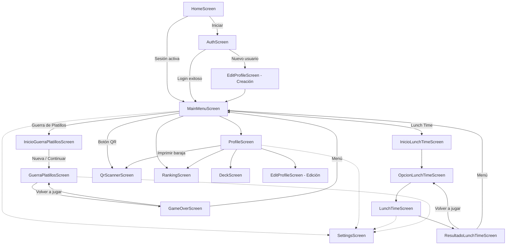

# Documentación del Proyecto: Nutri-life app (Código Verde)

**Grupo 2**  
* **Betancor Fernando**  
* **Rey Lucas**  
* **Rodríguez Stephany**  
* **Scodelari Julia**  

---

## 📑 Índice de Contenidos

1. [A. Descripción General y Juegos](#a-descripción-general-y-juegos)
   * [Nombre de la app](#nombre-de-la-app)
   * [Objetivo](#objetivo)
   * [Público destinatario y Persona Usuaria](#público-destinatario-y-persona-usuaria)
   * [A1. Descripción del Juego 1: Lunch Time!](#a1-descripción-del-juego-1)
   * [A2. Descripción del Juego 2: Guerra de Platillos](#a2-descripción-del-juego-2)
   * [A3. Perfil de Usuario, Baraja y Escáner QR](#a3-perfil-de-usuario-baraja-y-escáner-qr)
2. [B. Estructura de la Aplicación](#b-estructura-de-la-aplicación)
   * [Esquema conceptual del flujo](#esquema-conceptual-del-flujo)
   * [Diagrama de navegación entre pantallas](#diagrama-de-navegación-entre-pantallas)
   * [Descripción detallada de pantallas y sus relaciones](#descripción-detallada-de-pantallas-y-sus-relaciones)
3. [C. Prototipo y Design System](#c-prototipo-y-design-system)
   * [Enlaces a Prototipos y Diseño en Figma](#enlaces-a-prototipos-y-diseño-en-figma)
   * [Decisiones visuales: Paleta de Colores y Accesibilidad](#decisiones-visuales-paleta-de-colores-y-accesibilidad)
   * [Tipografías y Jerarquía de Texto](#tipografías-y-jerarquía-de-texto)
   * [Componentes de Interfaz: Botones](#componentes-de-interfaz-botones)
   * [Recursos gratuitos usados como inspiración](#recursos-gratuitos-usados-como-inspiración)
   * [Estrategia de Navegación entre Pantallas](#estrategia-de-navegación-entre-pantallas)
4. [D. Implementación Técnica](#d-implementación-técnica)
   * [Arquitectura MVVM](#arquitectura-mvvm)
   * [Persistencia local con Room / SQLite](#persistencia-local-con-room--sqlite)
   * [Backend en la nube con Firebase (Auth y Firestore)](#backend-en-la-nube-con-firebase-auth-y-firestore)
   * [Sensor utilizado y respuesta háptica](#sensor-utilizado-y-respuesta-háptica)
   * [Cámara, Escáner QR y PDF local](#cámara-escáner-qr-y-pdf-local)
   * [Administración del estado y ciclo de vida](#administración-del-estado-y-ciclo-de-vida)
   * [Recursos multimedia incorporados](#recursos-multimedia-incorporados)
   * [Librerías y componentes de Android utilizados](#librerías-y-componentes-de-android-utilizados)
5. [E. Participación de los Integrantes](#e-participación-de-los-integrantes)

---

## A. Descripción General y Juegos

### Nombre de la app
**Nutri-life app: Código Verde**

### Objetivo
Concientizar y educar a los adolescentes sobre los beneficios de una alimentación sana, variada y equilibrada, visibilizando el impacto negativo del consumo habitual de alimentos ultraprocesados, grasas saturadas y azúcares refinados. A través de la gamificación, el jugador asume el desafío de armar menús nutritivos y comparar platillos para potenciar las estadísticas de **Salud**, **Saciedad** y **Vitalidad/Energía**, aprendiendo a tomar decisiones informadas en su vida cotidiana.

### Público destinatario y Persona Usuaria

Nuestra aplicación está orientada para niños de 13 años de edad, que residen en Argentina, donde la misma puede implementarse en el colegio principalmente en una actividad en la materia de biología.  
Se puede utilizar tanto con una mano como con las dos, y soporta tanto orientación vertical como horizontal (apaisada); la idea es que los juegos no duren tanto tiempo y el usuario no se aburra entre partidas.  
Los juegos favoritos de los niños de este rango etario son Minecraft y Roblox.  
Buscamos evitar problemas comunes como botones muy chicos, colores sin armonía o interfaces pensadas para PC que no se adaptan bien al teléfono.

#### User Persona: Mateo
Nuestro user persona es un chico de secundaria llamado Mateo. Él tiene 13 años, vive en Argentina y acude todos los días a un colegio secundario. El colegio de Mateo tiene doble jornada, por lo que el chico come muchas de sus comidas diarias en el colegio y, en general, sus padres le dan plata para que se compre lo que él quiere en el quiosco del colegio.  
Cuando no está en el colegio, Mateo pasa la mayor parte de su tiempo en redes sociales como TikTok y YouTube y también juega muchos juegos online, sobre todo en la plataforma Android, en el smartphone que le regalaron sus padres cuando comenzó el secundario para poder comunicarse con ellos. También juega algunos juegos de PC, sobre todo Minecraft y Roblox.  
A Mateo le gusta mucho educación física y plástica, pero le cuestan otras materias porque tiene algunos problemas para concentrarse, distraído por las constantes imágenes coloridas de las pantallas; muchas veces le cuesta leer o simplemente se saltea los textos que tiene enfrente para concentrarse en lo visual.

#### Descripción general
Esta aplicación funciona como un compañero saludable para adolescentes que recién están ingresando a la secundaria; la idea es que sus juegos puedan ser jugados en el ámbito escolar y ser compartidos entre los estudiantes, de forma recreativa y competitiva. Por esta razón, la aplicación incluye una sección de perfil, donde los usuarios pueden personalizar su avatar, apodo y hacer un seguimiento de sus puntajes máximos, rachas y hábitos semanales.  
La aplicación incluye distintos tipos de interacciones con objetos del mundo real: viene acompañada de cartas físicas que se pueden escanear mediante un código QR para ver el detalle dentro de la app y además trae un archivo PDF imprimible con la baraja (accesible escaneando el QR correspondiente), para que los usuarios puedan jugar también fuera del teléfono.

Código Verde está conformada por dos juegos, con objetivos y mecánicas diferentes que son complementarios.

---

## A1. Descripción del Juego 1

### Nombre del juego
**Lunch Time!**

### Mecánica principal
* **Modalidad de Selección de Comida:**
  * **Modo Horario (Automático):** La aplicación detecta el horario real del sistema y sugiere la comida adecuada:
    * De 06:00 a 10:59 hs: **Desayuno**
    * De 11:00 a 14:59 hs: **Almuerzo**
    * De 15:00 a 18:59 hs: **Merienda**
    * De 19:00 a 23:59 hs: **Cena**
  * **Modo Personalizado (Manual):** El jugador escoge libremente qué tiempo de comida desea jugar.
* **Selección de Alimentos contra Reloj:** Durante una cuenta regresiva de **20 segundos**, el jugador debe armar su bandeja seleccionando hasta un máximo de **3 alimentos** entre las opciones disponibles del catálogo para esa comida.
* **Sistema de Semáforo y Puntuación Nutricional:** Cada alimento tiene atributos individuales de Salud (0 a 2 pts), Saciedad (0 a 2 pts) y Vitalidad (0 a 2 pts). Los alimentos saludables aportan hasta 2 puntos por atributo, mientras que los ultraprocesados o poco saludables aportan 0 puntos en salud/vitalidad:
  * 🟢 **Verde (Muy Saludable):** Alimentos naturales o mínimamente procesados con alto valor nutricional.
  * 🟡 **Amarillo (Normal / Moderado):** Opciones intermedias con equilibrio de nutrientes.
  * 🔴 **Rojo (Poco Saludable / Ultraprocesado):** Alimentos ricos en harinas refinadas, azúcares y grasas saturadas.
* **Condición de Victoria / Derrota:** Para ganar la partida, el jugador debe alcanzar al menos el **60% del puntaje máximo posible** (11 de 18 puntos combinados). Si elige ultraprocesados, su puntaje no superará el umbral y perderá la partida.

### Forma de interacción del jugador
* **Diseño ergonómico y responsivo:** Diseñado para jugarse tanto con una mano como con dos, en sesiones cortas de 1 a 2 minutos. En orientación horizontal, la grilla pasa automáticamente a 3 columnas con el temporizador y el botón de confirmación en un panel lateral.
* **Selección directa mediante tarjetas interactivas:** Tocar una tarjeta de alimento la añade automáticamente a la bandeja de comida, actualizando el borde resaltado, el tilde de confirmación y el contador en tiempo real (`Bandeja X/3`). Al volver a tocarla, se retira de la bandeja.
* **Feedback auditivo y visual:** Respuestas sonoras inmediatas tipo burbuja al seleccionar, sonido de urgencia durante los últimos 5 segundos del temporizador y alertas sonoras si se intenta superar el límite de 3 alimentos.
* **Acceso rápido:** Acceso permanente para volver atrás o abrir la configuración desde la cabecera superior.

### Recorrido general de la partida
1. **Inicio de Lunch Time (`InicioLunchTimeScreen`):** Presentación con portada y descripción breve; al pulsar *"¡JUGAR! ▷"* avanza a la elección de comida.
2. **Elección de Modo de Menú (`OpcionLunchTimeScreen`):** El jugador decide si jugar con el menú del horario actual (detectado automáticamente) o seleccionar manualmente una comida mediante chips interactivos (Desayuno, Almuerzo, Merienda o Cena).
3. **Ronda de Juego Activa (`LunchTimeScreen`):**
   * Se inicia el temporizador de 20 segundos.
   * Se muestran los alimentos correspondientes a la comida elegida con su imagen y nombre.
   * El jugador selecciona hasta 3 alimentos antes de que el reloj llegue a cero, o confirma anticipadamente pulsando *"CONFIRMAR MENÚ"*.
4. **Resultados y Retroalimentación (`ResultadoLunchTimeScreen`):**
   * Se muestra si la partida fue **Ganada** o **Perdida** con ilustración y encabezado alusivo (en modo horizontal se oculta la ilustración para priorizar los puntajes).
   * Se visualizan los puntos obtenidos en Salud, Saciedad y Vitalidad mediante círculos animados, junto con el puntaje total y porcentaje.
   * Se exhibe una tarjeta de *"¿Sabías qué…?"* con datos curiosos sobre los platos seleccionados.
   * La partida se registra automáticamente en **Room/SQLite** para alimentar el historial semanal del perfil.

---

## A2. Descripción del Juego 2

### Nombre del juego
**Guerra de Platillos**

### Mecánica principal
El enfrentamiento se desarrolla bajo una modalidad de **3 contiendas (rondas)** entre el Jugador y la Inteligencia Artificial (Rival), donde cada bando recibe 3 cartas aleatorias del mazo de 23 platillos (`assets/cartas.json`).

### Forma de interacción del jugador
El jugador ingresa a la aplicación con su cuenta (**Firebase Auth** — inicio de sesión o registro con apodo, email y contraseña — más la creación/edición de su **Avatar**). Desde el menú principal (`MainMenuScreen`) puede iniciar una partida de *Guerra de Platillos* (o **continuar una partida guardada** si quedó inconclusa), acceder a *Lunch Time*, escanear cartas por QR, abrir su perfil o consultar el ranking global.

### Recorrido general de la partida
* **Fase de Mezclado y Reparto:** Al iniciar una partida nueva, el mazo completo de 23 cartas se mezcla y se reparten 3 cartas al jugador y 3 al rival. El estado se persiste automáticamente en **Room/SQLite** en cada jugada para poder retomar la partida en otro momento.
* **Fase de Colocación (boca abajo):** En cada ronda, el jugador **arrastra una carta hacia arriba** para jugarla sobre el tablero VS (también puede tocar cualquier carta para ver su imagen completa en detalle). Simultáneamente, el rival coloca su carta boca abajo.
* **Fase de Revelación:** Ambas cartas permanecen boca abajo hasta que el usuario **agita el teléfono** (detectado por el acelerómetro mediante `ShakeDetector`, acompañado de vibración háptica) o toca el banner en pantalla. Al revelarse, se muestran los puntajes con **sistema semáforo** (`0–30` rojo, `31–65` amarillo, `66+` verde) para identificar rápidamente la calidad nutricional de cada platillo.

Las tres fases se realizan 3 veces (una **mano** completa de 3 rondas). El criterio para determinar el ganador de cada contienda evalúa los tres atributos nutricionales de las cartas (0–100):
* **Energía (`E`):** Evalúa la calidad y duración del aporte calórico (energía sostenida vs. picos efímeros de azúcar).
* **Saciedad (`S`):** Mide la capacidad del alimento para mantener satisfecho al organismo (fibra y proteína vs. digestión veloz y antojos).
* **Vitalidad (`V`):** Representa la densidad de nutrientes, antioxidantes y el impacto positivo en la salud general.

El puntaje se resuelve así:
* **Ganador de la ronda:** Quien gana más categorías (2 de 3, o las 3) gana la ronda y suma la diferencia de puntos de las categorías ganadas. En caso de empate en categorías ganadas, ambos suman la diferencia de la categoría que ganó cada uno.
* **Fin de la partida (`GameOverScreen`):** Tras las 3 rondas, se descarta el guardado temporal de partida en curso en Room, y el resultado final se registra en **Cloud Firestore** (`matches` y `users/{uid}`) para actualizar el mejor puntaje, la racha, las partidas ganadas y el **Ranking Global**.

---

## A3. Perfil de Usuario, Baraja y Escáner QR

### Perfil del Usuario (`ProfileScreen`)
El perfil centraliza el progreso del jugador combinando datos de la nube (**Firestore**) y del historial local (**Room/SQLite**):
* **Identidad:** Muestra el avatar elegido, nombre/apodo y acceso directo a editar el perfil (`EditProfileScreen`).
* **Accesos rápidos:**
  * **🃏 Ver baraja (`DeckScreen`):** Galería deslizable con las 23 cartas del mazo, mostrando su vista en miniatura con puntajes semáforo y la imagen completa al tocar cada carta.
  * **🖨️ Imprimir baraja (`QrScannerScreen` en modo `PRINTABLE_DECK`):** Abre la cámara para escanear el QR `codigoverde:baraja_imprimible` y abrir el PDF imprimible alojado en `assets/baraja_imprimible.pdf` mediante `FileProvider`. Si se escanea cualquier otro código QR, muestra una alerta amigable (*"¡Ups! Baraja no encontrada 🃏"*).
  * **🏆 Ver ranking (`RankingScreen`):** Tabla global ordenada por mejor puntaje desde Firestore.
* **Estadísticas clave:**
  * **Días sin ultraprocesados:** Racha de días consecutivos donde todas las partidas de *Lunch Time* obtuvieron al menos 4 de 6 puntos en cada categoría (Salud, Saciedad y Vitalidad).
  * **Racha de juego:** Días consecutivos jugando *Guerra de Platillos*.
  * **Partidas ganadas:** Total de victorias registradas en Firestore.
* **Seguimiento semanal ("Días sin ultraprocesados esta semana"):** Cuadrícula de lunes a domingo alimentada desde Room/SQLite con código de color semáforo según el puntaje mínimo del día en *Lunch Time*:
  * 🔴 **Rojo:** alguna partida del día obtuvo menos de 6 puntos.
  * 🟡 **Amarillo:** puntaje mínimo del día entre 6 y 12 puntos.
  * 🟢 **Verde:** puntaje mínimo del día de 13 puntos o más.
  * Al tocar cualquier día de la semana se abre un diálogo con el detalle de las partidas jugadas ese día (comida, horario y puntajes por categoría).
* **Tarjeta "¿Sabías qué?":** Muestra un dato curioso aleatorio cargado dinámicamente desde `assets/datos_curiosos.json`.

### Escáner QR desde el Menú Principal (`QrScannerScreen` en modo `CARD_DETAIL`)
Desde el botón circular amarillo con ícono QR en `MainMenuScreen`, el usuario puede apuntar la cámara a las cartas físicas impresas:
* Lee códigos con el prefijo **`codigoverde:{id}`** (por ejemplo `codigoverde:salmon`, `codigoverde:calabaza`).
* Si el ID existe en `cartas.json`, muestra la imagen completa de la carta en un overlay sobre la cámara (permitiendo cerrar la carta o salir con la flecha superior sin que vuelva a dispararse mientras se siga apuntando al mismo QR).

---

## B. Estructura de la Aplicación

### Esquema conceptual del flujo
Siguiendo las pautas pedagógicas del desarrollo de juegos educativos, el flujo de interacción responde al siguiente ciclo:

```text
Acceso (Firebase Auth / Avatar) → Menú Principal → Elección de Juego o Escáner QR → Partida (Contrarreloj o Duelo de Cartas) → Resultado y Retroalimentación → Registro en Room / Firestore → Perfil y Ranking
```

### Diagrama de navegación entre pantallas



### Descripción detallada de pantallas y sus relaciones

| Pantalla | Composable / Archivo | Rol en la experiencia del usuario | Transición y comunicación |
| :--- | :--- | :--- | :--- |
| **Portada** | `HomeScreen` | Pantalla de bienvenida inicial con logo y acceso. | Verifica sesión en `AuthRepository` y navega a `AuthScreen` o `MainMenuScreen`. |
| **Autenticación** | `AuthScreen` | Registro e inicio de sesión con email y contraseña mediante Firebase Auth. | Al autenticarse, dirige a creación de avatar (si es nuevo) o al menú principal. |
| **Crear / Editar Perfil** | `EditProfileScreen` | Selección de avatar (ilustraciones) y nombre/apodo. | Persiste datos en `UserRepository` / Firestore y vuelve al menú o perfil. |
| **Menú Principal** | `MainMenuScreen` | Hub central con tarjetas para *Lunch Time* y *Guerra de Platillos*, botón QR circular, Perfil y Ranking (adaptado a vertical y horizontal). | Navega mediante `AppNavHost` según la acción elegida. |
| **Inicio Lunch Time** | `InicioLunchTimeScreen` | Presentación de *Lunch Time* con portada y explicación (con scroll en horizontal). | Navega a `OpcionLunchTimeScreen`. |
| **Selección de Menú** | `OpcionLunchTimeScreen` | Modo automático según horario del sistema o selección manual de comida. | Inicia `LunchTimeScreen` a través de `LunchTimeViewModel`. |
| **Juego Lunch Time** | `LunchTimeScreen` | Grilla responsiva (2 cols vertical / 3 cols horizontal), bandeja de 3 alimentos y timer de 20s. | Al confirmar o expirar el tiempo, guarda en Room y va a `ResultadoLunchTimeScreen`. |
| **Resultado Lunch Time** | `ResultadoLunchTimeScreen` | Veredicto, círculos animados por categoría y *"¿Sabías qué?"*. | Permite volver a jugar o regresar al menú. |
| **Inicio Guerra de Platillos** | `InicioGuerraPlatillosScreen` | Muestra mejor puntaje y botón *"¡JUGAR! ▷"* o *"CONTINUAR PARTIDA ▷"* + *"NUEVA PARTIDA"* si hay partida en Room. | Navega a `Game` pasando el parámetro `continuar` (`true`/`false`). |
| **Juego Guerra de Platillos** | `GuerraPlatillosScreen` | Tablero VS, cartas arrastrables con puntajes semáforo y detección de sacudida con acelerómetro. | Persiste cada jugada en Room; al finalizar descarta la partida en curso y va a `GameOverScreen`. |
| **Fin de Juego (Guerra)** | `GameOverScreen` | Marcador final Vos vs. Rival y veredicto de la partida. | Registra estadísticas en Firestore; permite revancha o volver al menú. |
| **Perfil del Jugador** | `ProfileScreen` | Estadísticas de Firestore, seguimiento semanal desde Room, dato curioso y accesos rápidos. | Conecta con `DeckScreen`, `QrScannerScreen` (PDF), `RankingScreen` y `EditProfileScreen`. |
| **Galería de Baraja** | `DeckScreen` | Lista deslizable de las 23 cartas con sus miniaturas, puntajes semáforo y modal de detalle. | Permite inspeccionar todas las cartas del juego. |
| **Escáner QR** | `QrScannerScreen` | Vista de cámara con CameraX + ML Kit para escanear cartas (`codigoverde:{id}`) o la baraja imprimible (`codigoverde:baraja_imprimible`). | Muestra detalle de carta en overlay o abre el PDF local con `FileProvider`. |
| **Ranking Global** | `RankingScreen` | Lista de mejores puntajes de todos los jugadores. | Lee los puntajes ordenados desde Cloud Firestore. |
| **Configuración** | `SettingsScreen` | Activa/desactiva audio, alterna paletas de daltonismo y permite cerrar sesión. | Guarda preferencias reactivas en `SettingsRepository`. |

---

## C. Prototipo y Design System

### Enlaces a Prototipos y Diseño en Figma
* **Figma con ideas de diseños:** [Figma - Ideas de Diseño Código Verde](https://www.figma.com/design/0FFUgH8JY8tdWQKZwHYNxw/C%C3%B3digo-Verde?node-id=0-1&t=GePfTl6c2rRsv8mP-1)
* **Figma con flujo de pantallas:** [Figma - Flujo de Pantallas Código Verde](https://www.figma.com/design/zpR1UfmqXWgEzf0P6405iV/APP-CODIGO-VERDE?node-id=0-1&t=jVcKDDquxswSxvkc-1)

### Decisiones visuales: Paleta de Colores y Accesibilidad

* **#172929 - Fondo Principal:** Este tono oscuro profundo es la base de toda la interfaz. Elegimos un fondo oscuro para reducir la fatiga visual en sesiones de juego y para que los colores del semáforo y los textos claros resalten con fuerza sobre él. Además, genera una estética moderna que conecta con los juegos que ya consume nuestro público.
* **#E7F1F2 - Texto Primario:** Este tono hielo/casi blanco es el color principal de lectura. Sobre el fondo oscuro ofrece un contraste alto y limpio, ideal para títulos, párrafos y toda la información que el jugador necesita leer cómodamente.
* **#86BCBD - Texto Secundario y Elementos de Apoyo:** Este turquesa suave lo usamos como segundo nivel de texto y para elementos de la UI que acompañan sin competir: subtítulos, etiquetas, hints en campos de texto, bordes decorativos y botones secundarios (como el de menú o configuración).
* **#A4CE8B - Texto Resaltado y Éxito (Verde Semáforo):** Este verde pastel cumple doble función: por un lado resalta la información importante dentro de los textos (highlights), y por el otro es el color principal de los botones de acción ("Jugar", "Aceptar", "Siguiente") y el indicador de éxito en el sistema semáforo. Es nuestro verde elegido para marcar las elecciones saludables.
* **#F7E49B - Advertencia (Amarillo Semáforo):** Amarillo cálido para el nivel intermedio del semáforo. Marca las opciones "normales" que no son ni las más saludables ni las peores. También lo usamos para avisos, estados de atención y el botón circular de escáner QR.
* **#BA5A5A - Error y Alertas (Rojo Semáforo):** Rojizo terroso para contrastar fuertemente y llamar la atención en situaciones críticas: indicadores de alimentos poco saludables, notificaciones de error y el nivel rojo del semáforo.

La paleta de colores fue pensada con tres cosas en mente. Primero, que sea atractiva y con personalidad para conectar con el público joven, usando colores naturales que se relacionan con los grupos alimenticios y la naturaleza. Segundo, que genere un contraste alto y claro entre fondo oscuro, texto claro y colores de acento, respetando las normativas de accesibilidad. Por último, añadimos dos paletas de colores extras para dos "modos daltónicos" diferentes, implementadas como temas alternativos que el usuario puede activar desde la configuración de la app.

#### Paleta para Protanopia / Deuteranopia

| Color original | Equivalente | Uso |
|:-:|:-:|:--|
| #BA5A5A | #90905A | Error / Semáforo rojo |
| #F7E49B | #EEEFAD | Advertencia / Semáforo amarillo |
| #A4CE8B | #B7B79B | Éxito / Semáforo verde / Botón primario |
| #86BCBD | #9D9EBD | Texto secundario / Botón secundario |
| #E7F1F2 | #EBEBF3 | Texto primario |
| #172929 | #1F1F29 | Fondo |

#### Paleta para Tritanopia

| Color original | Equivalente | Uso |
|:-:|:-:|:--|
| #BA5A5A | #B5595A | Error / Semáforo rojo |
| #F7E49B | #F6BBBF | Advertencia / Semáforo amarillo |
| #A4CE8B | #A7A8AC | Éxito / Semáforo verde / Botón primario |
| #86BCBD | #89BCBD | Texto secundario / Botón secundario |
| #E7F1F2 | #E8F2F2 | Texto primario |
| #172929 | #192929 | Fondo |

Link a la paleta de colores: [Palette Checker](https://palettechecker.com/#BA5A5A-F7E49B-A4CE8B-86BCBD-E7F1F2-172929)

### Tipografías y Jerarquía de Texto

Para la tipografía elegimos OpenDyslexic, ya que es una tipografía divertida, con personalidad, que facilita la lectura a personas disléxicas y con problemas de atención. Además es gratuita y Open Source. Está definida como fuente global del tema, aplicándose a todos los textos de la app automáticamente.

Se definieron cuatro niveles de tamaño de texto:
* **Títulos (28sp):** Para pantallas principales, nombres de secciones y resultados de partida.
* **Subtítulos (20sp):** Para encabezados de sección dentro de una pantalla, como las comidas del menú.
* **Texto general (16sp):** Para descripciones, datos de alimentos, sección "¿Sabías qué?" y textos informativos.
* **Texto de botón (18sp):** Para el texto dentro de los botones, lo suficientemente grande para leerse sin esfuerzo.

Documentación oficial: [OpenDyslexic](https://opendyslexic.org/)

### Componentes de Interfaz: Botones

Los botones tienen esquinas redondeadas y la tipografía OpenDyslexic sin mayúsculas forzadas, para mantener la legibilidad y la personalidad visual de la app.

Los **botones de acción principal (`PrimaryButton`)** (como "Jugar", "Aceptar", "Confirmar Menú") usan el color verde de éxito (#A4CE8B) con texto oscuro (#172929). Ocupan el ancho disponible (o se ubican lado a lado en modo horizontal) y se posicionan en la parte inferior de la pantalla para que sean de fácil acceso.

Los **botones secundarios (`SecondaryButton` y `CircleIconButton`)** usan el color turquesa (#86BCBD) con texto oscuro. Los botones circulares de cabecera (`CircleIconButton`) se ubican en la parte superior izquierda (volver/cerrar) y derecha (ajustes), con tamaño táctil cómodo para evitar toques accidentales.

### Recursos gratuitos usados como inspiración

* [Botones Trendy en Figma](https://www.figma.com/design/ppNLYbER8ipWWv9QGg1O5h/Trendy-Buttons--Community-?node-id=0-1&t=6PhVaQbMiiN6wuf6-1)
* [Interactive Buttons Set en Figma](https://www.figma.com/design/wMrYdqKOV5LTSREcoZhzVp/Interactive-Buttons-set-by-Nikica--Community-?node-id=1-201&p=f)
* [Interfaz Shopping App en Figma](https://www.figma.com/design/iT747ijREVzySCe8EmBYUf/Shoping-App-Iphone--Community-?node-id=0-1&t=nuA7Iqe7vNznlauL-1)

### Estrategia de Navegación entre Pantallas

La aplicación evolucionó de múltiples Activities XML a una arquitectura **Single-Activity (`MainActivity`) con Jetpack Compose y Navigation Compose (`AppNavHost`)**. Todas las pantallas son `@Composable` declarativos conectados mediante rutas tipadas en `Routes`, lo que permite transiciones fluidas, paso de argumentos (`playerScore`, `rivalScore`, `continuar`, `mode`), gestión limpia del back stack (`popUpTo`, `launchSingleTop`) y adaptación automática a orientación vertical y horizontal.

---

## D. Implementación Técnica

### Arquitectura MVVM
El proyecto está construido bajo el patrón **MVVM (Model - View - ViewModel)** separando responsabilidades en capas:

1. **Model (Capa de Datos y Dominio):**
   * **Modelos:** `Alimento`, `Avatar`, `Comida`, `DatoCurioso`, `CardModel`, `ReglasJuego`, `ResultadoPartida`.
   * **Repositorios locales y remotos:**
     * `AlimentoRepository` y `DatoCuriosoRepository`: cargan los datasets JSON/TXT desde `assets/`.
     * `DeckRepository`: parsea las 23 cartas desde `assets/cartas.json`.
     * `LunchTimeHistoryRepository` y `GuerraGameRepository`: administran la persistencia local en Room.
     * `AuthRepository`, `UserRepository` y `SettingsRepository`: gestionan sesión, datos en Firestore y preferencias locales.
2. **ViewModel (Capa de Estado y Presentación):**
   * `AuthViewModel`, `LunchTimeViewModel`, `GameViewModel`, `ProfileViewModel` y `RankingViewModel`.
   * Exponen estado reactivo (`StateFlow` y estado observable de Compose) y eventos de un solo consumo mediante `Channel` / `Flow`, sobreviviendo a rotaciones de pantalla.
3. **View (Capa de Interfaz de Usuario en Jetpack Compose):**
   * Pantallas `@Composable` stateless/stateful dentro de `ui/screens/`, reutilizando componentes comunes (`ScreenContainer`, `PrimaryButton`, `SecondaryButton`, `CircleIconButton`, `BorderCard`) y tema accesible (`GuerraDePlatillosTheme`).

### Persistencia local con Room / SQLite
La base de datos local `AppDatabase` (`codigo_verde.db`, versión 2 con `MIGRATION_1_2`) se implementó con **Room + KSP** para dos funcionalidades concretas:

1. **Historial de Lunch Time (`LunchTimeDao` + `LunchTimeHistoryRepository`):**
   * Tablas `lunch_time_partidas` y `lunch_time_platos` (relacionadas mediante `ForeignKey` con `onDelete = CASCADE` y `@Relation` en `PartidaConPlatos`).
   * Cada partida guarda `userId`, fecha normalizada (`fechaDia`), timestamp, tipo de comida y puntajes de Salud, Saciedad y Vitalidad.
   * Permite consultar el rango de lunes a domingo de la semana actual para pintar los cuadraditos semáforo del perfil, calcular los días consecutivos sin ultraprocesados y mostrar el detalle de partidas al tocar un día.
2. **Guardado y reanudación de Guerra de Platillos (`GuerraPartidaDao` + `GuerraGameRepository`):**
   * Tablas `guerra_partida_en_curso` (clave primaria `userId`) y `guerra_mano_cartas` (cartas restantes de jugador y rival, con `ForeignKey` `CASCADE`).
   * Utiliza `@Upsert` y transacciones `@Transaction` junto con `Mutex` y `NonCancellable` para guardar el estado tras cada acción (`startNewGame`, `playCard`, `revealCurrentRound`, `clearBoardForNextRound`) sin perder las manos por borrados en cascada.
   * Si existe una partida guardada para el usuario actual, `InicioGuerraPlatillosScreen` ofrece **"CONTINUAR PARTIDA ▷"**; al finalizar el duelo se descarta el guardado en Room.

### Backend en la nube con Firebase (Auth y Firestore)
* **Firebase Authentication:** Gestiona el registro, inicio y cierre de sesión con correo y contraseña en `AuthRepository`.
* **Cloud Firestore:**
  * Colección `users/{uid}`: almacena perfil/apodo, avatar, `highScore`, partidas ganadas y datos de racha.
  * Colección `matches`: registra los resultados de las partidas finalizadas de *Guerra de Platillos* para calcular estadísticas del perfil y alimentar el **Ranking Global** (`RankingScreen`).

### Sensor utilizado y respuesta háptica
* **Acelerómetro (`ShakeDetector`):** Implementado sobre `SensorManager` (`Sensor.TYPE_ACCELEROMETER`) en `GuerraPlatillosScreen` / `GameViewModel`, registrando el listener en `ON_RESUME` y liberándolo en `ON_PAUSE`.
* **Función en el juego:** Cuando ambos jugadores colocaron su carta boca abajo sobre el tablero, agitar el teléfono supera el umbral de aceleración configurado y ejecuta `revealCurrentRound()` para dar vuelta ambas cartas simultáneamente, acompañado de **respuesta háptica** (`Vibrator` / `VibrationEffect`) y efecto sonoro. También se ofrece un banner táctil alternativo en pantalla para dispositivos sin sensor o pruebas rápidas.

### Cámara, Escáner QR y PDF local
* **CameraX + ML Kit (`QrScannerScreen`):** Integra `PreviewView` e `ImageAnalysis` configurado con `BarcodeScanning` restringido a `FORMAT_QR_CODE`, solicitando el permiso `CAMERA` en tiempo de ejecución.
* **Modos de uso:**
  * **Escanear carta (`codigoverde:{id}`):** Busca la carta en `DeckRepository` y la muestra en un overlay sin bloquear la cabecera de navegación, evitando re-disparos mientras se siga apuntando al mismo QR.
  * **Imprimir baraja (`codigoverde:baraja_imprimible`):** Copia `assets/baraja_imprimible.pdf` al caché interno y lo abre mediante `FileProvider` (`Intent.ACTION_VIEW` con `application/pdf`). Ante cualquier otro QR muestra la alerta *"¡Ups! Baraja no encontrada 🃏"*.

### Administración del estado y ciclo de vida
* **Compose State y `StateFlow`:** El estado de las pantallas y partidas se mantiene en `ViewModel`s, conservando temporizador, selección de bandeja o cartas en mesa ante rotaciones.
* **Gestión de ciclo de vida (`LocalLifecycleOwner` + `DisposableEffect`):**
  * En `LunchTimeScreen`: `ON_RESUME` reanuda el temporizador y `ON_PAUSE` lo pausa.
  * En `GuerraPlatillosScreen`: `ON_RESUME` activa `ShakeDetector` y `ON_PAUSE` detiene el sensor para ahorrar batería.
  * En `QrScannerScreen`: libera la cámara (`unbindAll()`), el `BarcodeScanner` y el `ExecutorService` en `onDispose`.
  * En `GuerraDePlatillosApp` / `MainActivity`: inicializa Room, repositorios y `SoundManager`.

### Recursos multimedia incorporados
* **Motor de Efectos Sonoros (`SoundManager`):** Implementado con `android.media.SoundPool` (`AudioAttributes.USAGE_GAME`) y efectos en `res/raw` (`sfx_btn_bubbly`, `sfx_btn_play`, `sfx_urgency_timer`, `sfx_game_finish`, `sfx_result_positive`, `sfx_result_negative`, `sfx_error`).
* **Tipografía Accesible:** Fuente `OpenDyslexic` en `res/font/`, aplicada globalmente desde `GuerraDePlatillosTheme`.
* **Ilustraciones y Drawables:** Portadas, avatares, íconos vectoriales (`ic_qr_code`, `ic_arrow_back`, `ic_settings`, `ic_close`), imágenes completas y miniaturas (`_mini`) para las 23 cartas de *Guerra de Platillos* y los 40 alimentos de *Lunch Time*.

### Librerías y componentes de Android utilizados
* **UI y Navegación:** Jetpack Compose, Material 3, `androidx.navigation:navigation-compose`, `androidx.activity:activity-compose`.
* **Arquitectura y Concurrencia:** `lifecycle-viewmodel-compose`, `lifecycle-runtime-compose`, Kotlin Coroutines (`StateFlow`, `Flow`, `Mutex`).
* **Base de datos local:** `androidx.room` (`room-runtime`, `room-ktx`, `room-compiler` vía KSP).
* **Nube:** Firebase Authentication y Cloud Firestore (`firebase-bom`).
* **Cámara y QR:** `androidx.camera` (`camera-core`, `camera-camera2`, `camera-lifecycle`, `camera-view`) y Google ML Kit (`barcode-scanning`).
* **Nativos Android:** `SensorManager` (acelerómetro), `Vibrator` / `VibrationEffect`, `SoundPool`, `FileProvider`, `SharedPreferences`.

---

## E. Participación de los Integrantes

| Integrante | Rol en el equipo | Tareas realizadas |
| :--- | :--- | :--- |
| **Betancor Fernando** | *[Por completar]* | *[Por completar]* |
| **Rey Lucas** | *[Por completar]* | *[Por completar]* |
| **Rodríguez Stephany** | *[Por completar]* | *[Por completar]* |
| **Scodelari Julia** | Programación y documentación | Armado del readme.md, implementación del patrón MVVM, generación de assets (imágenes, sonidos, animaciones), implementación de base de datos en firestore y conexión desde la app. Armado de la lógica del perfil de usuario. |
